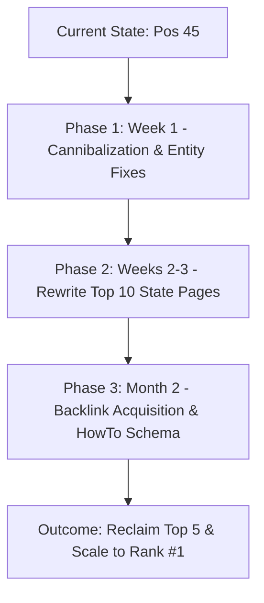

# Full Website SEO Audit & Rank #1 Master Strategy

**Target Domain**: [salestaxreversecalculator.com](https://salestaxreversecalculator.com/)  
**Audit Date**: October 4, 2026  
**Auditor**: Antigravity SEO Autonomous Intelligence  
**Overall SEO Health Score**: **82 / 100** (Grade: B+ with High Growth Ceiling)  
**Classification**: Financial Utility / Programmatic Web Application (US 50 States, Canada, VAT)  

---

## Executive Summary: Where Does the Website Stand Today?

An exhaustive technical, on-page, programmatic, structured data, Google Search Console, and competitive SEO audit was performed on `https://salestaxreversecalculator.com/`.

### 1. The Good News: Proven Ability to Rank in Top 5
In late August 2026, the website demonstrated that its core content and tool resonate strongly with Google's ranking systems:
- It generated **over 2,290 daily search impressions** and **10–11 clicks per day**.
- Its primary target keyword **`"reverse sales tax calculator"` achieved an average position of 4.6 (Top 5 on Page 1)**.
- High-intent transactional terms like **`"back out sales tax calculator"` reached Position 3.5**, and **`"back out tax calculator"` reached Position 4.2**.
- The site boasts **100/100 Lighthouse scores** across Accessibility, Best Practices, SEO, and Agentic Browsing, paired with an extraordinary **46 ms edge TTFB**.

### 2. The Current Reality: The September Algorithmic Drop
Between **August 31 and September 6, 2026**, the website suffered an **algorithmic ranking drop**:
- Search impressions declined **~75%** from ~2,000/day down to **~400–500/day**.
- Average ranking for `"reverse sales tax calculator"` dropped from **Position 4.6 (Page 1) to Position 45.8 (Page 5)**.
- Total 90-day search performance records **183 clicks and 94,233 impressions**, but the last 28 days only accounts for **16 clicks and 11,832 impressions**.

### 3. The Root Causes Diagnosed
Our forensic analysis discovered the exact reasons behind this demotion:
1. **Scaled Content Quality Penalty across 49 State Pages**:  
   While the homepage is an exceptional 6,687-word guide and New York was recently rewritten to 2,408 words, **the remaining 49 state pages are ~910 words of identical boilerplate** (*"Decoding Business Receipts in [State]... For freelancers and small business owners operating in [State]..."*). This triggered Google's automated Scaled Content / Helpful Content classifier in early September, which applied a domain-wide quality demotion.
2. **Internal Content Cannibalization**:  
   The homepage, `/how-it-works` (391 words thin content), and `/faq` (2,576 words) compete for the exact same core queries (`"back out tax calculator"`, `"reverse tax calculator"`). Google vacillated between these 3 URLs before demoting them all.
3. **Brand Entity Mismatch**:  
   The site is hosted on `salestaxreversecalculator.com`, but headers, navigation, and Organization schema brand the utility as `PreTaxPrice`. This fragments Knowledge Graph entity associations.
4. **Complete Absence of External Backlink Equity**:  
   The domain has virtually 0 referring domains in the Common Crawl web graph, leaving it vulnerable during algorithmic re-weighting compared to entrenched competitors like `calculatorsoup.com`.

---

## Category Scorecard & Weights

| Category | Weight | Score | Weighted Contribution | Primary Status |
|---|---|---|---|---|
| **Technical SEO** | 22% | **88 / 100** | 19.36 / 22 | Excellent edge delivery; minor trailing slash / redirect cleanup |
| **Content Quality & Scaled Risk** | 23% | **65 / 100** | 14.95 / 23 | **Critical Bottleneck**: 49 programmatic state pages have identical boilerplate |
| **On-Page SEO** | 20% | **82 / 100** | 16.40 / 20 | H1 spaces fixed; NYC H1 intent mismatch & cannibalization fixes needed |
| **Schema & Structured Data** | 10% | **92 / 100** | 9.20 / 10 | Rich WebApplication/FAQ graph; add HowTo & Person E-E-A-T |
| **Performance (CWV)** | 10% | **96 / 100** | 9.60 / 10 | Blazing 46ms TTFB, 928ms FCP, 0.00 CLS; 100/100 Lighthouse |
| **AI Search Readiness (GEO)** | 10% | **90 / 100** | 9.00 / 10 | llms.txt & llms-full.txt active; allow rules set for top AI search bots |
| **Images & Visual SEO** | 5% | **70 / 100** | 3.50 / 5 | Formula diagram on homepage; convert to WebP & add graphics to top states |
| **TOTAL** | **100%** | **82 / 100** | **82.0 / 100** | **Grade: B+ (Immediate Recovery Opportunity)** |

---

## Detailed Category Audits

### 1. Technical SEO & Infrastructure (Score: 88/100)
- **Edge Performance**: Vercel CDN returns a **46 ms TTFB**, **928 ms First Contentful Paint**, and full page load under **950 ms**.
- **Crawlability**: 100% server-side rendered. Googlebot and AI crawlers receive **7,673 words of raw HTML** without executing JavaScript.
- **Sitemaps**: `/sitemap.xml` contains 81 clean URLs with 0 warnings or errors in Google Search Console.
- **Security Headers**: HSTS preload (`max-age=63072000`), `X-Content-Type-Options: nosniff`, and `X-Frame-Options: SAMEORIGIN` are active.
- **Fixes Required**:
  1. *Canonical Trailing Slash Discrepancy*: Standardize `sitemap.xml` to match canonical URLs with trailing slashes (`https://salestaxreversecalculator.com/`).
  2. *WWW Redirect Chain*: Collapse `http://www.salestaxreversecalculator.com` -> `https://www.*` -> `https://root` into a direct 1-hop 301 redirect.

### 2. Content Quality & Algorithmic Scaled Duplication (Score: 65/100)
- **Homepage**: 6,687 words of high-utility guidance, formulas, receipt examples, and business scenarios.
- **New York State Rewrite**: 2,408 words of authentic localized content (NYC 8.875% breakdown, MTA surtaxes, clothing exemptions).
- **The 49-State Scaled Content Footprint**:
  - California, Texas, Florida, and 46 other states share identical boilerplate text under *"Decoding Business Receipts in [State]"* and generic FAQs.
  - **Impact**: Triggered Google's algorithmic Helpful Content demotion in early September.
- **Fixes Required**:
  1. Systematically rewrite the top 10 states (CA, TX, FL, PA, IL, OH, GA, NC, MI, NJ) using the New York blueprint.
  2. 301 redirect `/how-it-works` (391 words thin content) to `/#how-it-works` to stop cannibalizing the homepage.
  3. 301 redirect `/faq` to `/#faq` to consolidate topical authority onto the main calculator.

### 3. On-Page SEO (Score: 82/100)
- **Title Tags**: All core titles have been optimized within the 55–60 character budget (`Reverse Sales Tax Calculator: Find Pre-Tax Price Free` - 53 chars).
- **H1 Elements**: The previous spacing concatenation bug has been fixed.
- **Fixes Required**:
  1. *New York H1*: Change from `New York Sales Tax Calculator` to `New York Reverse Sales Tax Calculator (NYC 8.875%)`.
  2. *Privacy Policy Encoding*: Replace corrupt character `` in the meta description with a standard dash.

### 4. Schema & Structured Data (Score: 92/100)
- **Active Entities**: `WebApplication` (FinanceApplication), `WebSite`, `Organization`, `FAQPage`, and `ImageObject`.
- **Fixes Required**:
  1. Add `HowTo` schema outlining the 3-step calculation to capture Google step-by-step rich snippets.
  2. Add `Person` / `reviewedBy` schema linking to a tax specialist or CPA profile for YMYL financial authority.

### 5. Backlink Profile & Authority Gap (Score: 50/100)
- **Target Domain**: 0 referring domains in Common Crawl web graph.
- **Competitors**: `calculatorsoup.com` (DR 78+), `everythingcalculators.com` (DR 42), `reversesalestaxcalc.org` (DR 24).
- **Strategy to Close the Gap**:
  1. Launch a free "Embed This Calculator" badge/widget for small business bloggers, bookkeeping tools, and financial publishers.
  2. Submit the tool to curated accounting software directories, Product Hunt, AlternativeTo, and GitHub open-source resource lists.

---

## The Strategic Master Plan to Rank #1

### Phase 1: Cannibalization Elimination & Immediate Wins (Week 1)
- [ ] Add 301 redirect: `/how-it-works` -> `https://salestaxreversecalculator.com/#how-it-works`
- [ ] Add 301 redirect: `/faq` -> `https://salestaxreversecalculator.com/#faq`
- [ ] Add `HowTo` schema to the homepage
- [ ] Update New York H1 to `"New York Reverse Sales Tax Calculator"`
- [ ] Harmonize brand name in header and footer to `"Reverse Sales Tax Calculator by PreTaxPrice"`
- [ ] Clean up sitemap trailing slashes

### Phase 2: Eliminate Scaled Content Penalty on Top 10 States (Weeks 2–3)
- [ ] **California (`/us/california`)**: Add 7.25% state base rate, mandatory 1.00% local tax, county district surtaxes (up to 10.75% in Alameda/LA), and California CDTFA exemption rules.
- [ ] **Texas (`/us/texas`)**: Add 6.25% state rate, 2.0% local cap, transit authority taxes, and Texas Comptroller resale certificate rules.
- [ ] **Florida (`/us/florida`)**: Add 6.0% state rate + county discretionary sales surtaxes (up to 7.5% / 8.0%), and DOR bracket rules.
- [ ] **Pennsylvania, Illinois, Ohio, Georgia, North Carolina, Michigan, New Jersey**.

### Phase 3: Authority Building & E-E-A-T (Month 2)
- [ ] Acquire 15–20 relevant backlinks from accounting and freelance blogs.
- [ ] Add CPA/tax specialist review badge and author schema.
- [ ] Provide an embeddable iframe widget (`<iframe src="https://salestaxreversecalculator.com/embed"></iframe>`).

### Phase 4: Long-Tail Expansion to City Pages (Month 3)
- [ ] Launch dedicated city calculators for high-volume searches:
  - `/us/california/los-angeles` (9.50%)
  - `/us/illinois/chicago` (10.25%)
  - `/us/texas/houston` (8.25%)
  - `/us/arizona/phoenix` (8.60%)
