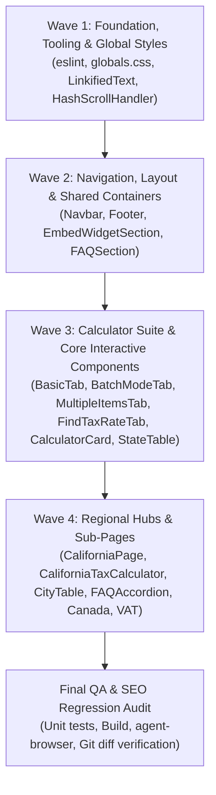

# UNIFIED UI/UX, ACCESSIBILITY & PERFORMANCE IMPROVEMENT PLAN
**Reverse Sales Tax Calculator (`salestaxreversecalculator.com`)**  
*Principal Orchestrator: Antigravity*  
*Date: November 3, 2026 | Version: 1.0.0*  
*Non-Negotiable Constraint: 100% SEO Preservation Enforced*

---

## 1. Executive Summary
An exhaustive multi-agent audit was conducted across seven independent domains:
1. **UI Guidelines & Usability** (`web-design-guidelines`)
2. **Visual Design & Aesthetics** (`frontend-design`, grounded in `DESIGN.md`)
3. **UI/UX & Design System Tokens** (`ui-ux-pro-max`)
4. **WCAG 2.2 AA Accessibility** (`accessibility`)
5. **Frontend Engineering & Component Architecture** (`frontend-ui-engineering`)
6. **React 19 & Next.js 16 Performance** (`vercel-react-best-practices`)
7. **Live Browser Automation & Viewport QA** (`agent-browser` on `http://localhost:3000`)

### Overall Website Condition
The website boasts a robust mathematical core (27 passing unit tests), clean static generation (88/88 SSG routes), zero horizontal overflow, and zero runtime JavaScript errors. It adheres closely to NerdWallet's spruce-and-mint visual language. However, the audit surfaced key opportunities for institutional polish:
- **Accessibility:** Broken skip-link targets on sub-pages; table sorting headers lacking keyboard/ARIA controls; inline `outline: none` stripping focus rings; duplicate DOM ID `id="calculator"`.
- **Visual Design:** The "danger red" sales tax output card; platform-dependent emoji icons in tab bars; card bloat in FAQs; heavy green border/glow on the California calculator card.
- **Frontend Architecture:** 12 duplicate calculator implementations; non-form `<button onClick>` in state/Canada/VAT calculators breaking keyboard `Enter` submission; broken ESLint tooling; direct DOM style mutations.
- **SEO DOM Safety:** `FAQAccordion.tsx` on the California page unmounts collapsed FAQ answers from initial SSR HTML, hiding them from crawlers.
- **Performance:** Non-interactive sections marked `'use client'`; unmemoized `localeCompare` running on every keystroke; synchronous analytics during first keypress; unneeded timer scheduling.

---

## 2. SEO Protection & Risk Assessment

Every task in this plan is evaluated against the **SEO Protection Policy**:
1. **Content Preservation:** ZERO text rewrites, rephrasing, or removals. Every word, worked example, citation, and FAQ answer is preserved verbatim.
2. **Heading Preservation:** ZERO changes to H1, H2, or H3 heading text. Heading hierarchy skips are fixed without altering any words.
3. **URL & Routing Preservation:** ZERO route renames, redirects, or canonical tag alterations.
4. **Metadata & Schemas:** All JSON-LD structured data (`WebSite`, `WebApplication`, `HowTo`, `FAQPage`, `Organization`) remain completely intact.
5. **SSR / Indexability:** Collapsed FAQ answers on California pages are restored to SSR DOM via CSS display toggles, actively improving crawlability.

---

## 3. Prioritized Implementation Tasks

### P0: Critical Usability, Accessibility & SEO Correctness
| Task ID | Component / Area | Problem Description | Proposed Solution | Relevant Files | Skill | SEO Risk |
|---|---|---|---|---|---|---|
| **T-P0-1** | California FAQ SSR | Collapsed FAQs unmounted via `{isOpen && 
}`, hiding questions 1-15 from SSR HTML. | Replace conditional mount with CSS display toggle (`display: isOpen ? 'block' : 'none'`) so all 16 FAQs exist in initial HTML payload. | `src/components/california/FAQAccordion.tsx` | `frontend-ui-engineering` | **Positive SEO Fix** |
| **T-P0-2** | Skip-Link Anchors | `<a href="#main-content">` fails on sub-pages because `<main>` lacks `id="main-content"`. | Add `id="main-content" tabIndex={-1}` to `<main>` tags across all page templates. | `CaliforniaPage.tsx`, `canada/page.tsx`, `vat-calculator/page.tsx`, `tax-rates/page.tsx`, `contact/page.tsx`, `about/page.tsx` | `accessibility` | Zero |
| **T-P0-3** | Table Sorting A11y | `CaliforniaCityTable.tsx` sorting headers are `<th>` with `onClick`, not keyboard operable. | Wrap sort headers in semantic `<button type="button">` with `aria-sort` and keyboard handlers. | `src/components/california/CaliforniaCityTable.tsx` | `accessibility` | Zero |
| **T-P0-4** | Focus Ring Suppression | Inline `outline: 'none'` overrides `:focus-visible` ring on inputs and textareas. | Remove inline `outline: 'none'` and ensure standard `.calc-input` focus ring is active. | `BatchModeTab.tsx`, `MultipleItemsTab.tsx`, `StateTable.tsx`, `ContactForm.tsx` | `accessibility` | Zero |
| **T-P0-5** | Duplicate DOM ID | Duplicate `id="calculator"` on both `<section>` and `<CalculatorCard>`. | Keep `id="calculator"` on `<section>` (preserving URL anchor `#calculator`); update card container to `id="calculator-card"`. | `src/components/calculator/CalculatorCard.tsx`, `src/app/(site)/page.tsx` | `accessibility` | Zero |
| **T-P0-6** | Result Card Red Hazard | Tax amount rendered in alarming "Danger Red" (`#fff8f8`, `#ffd8d8`, `#de2828`). | Refactor tax output card to clean neutral card (`var(--canvas)`, border `var(--hairline-strong)`, value in `var(--primary-deep)`). Reserve red solely for error alerts. | `src/components/calculator/BasicTab.tsx`, `src/app/globals.css` | `frontend-design` | Zero |
| **T-P0-7** | Linter Crash Fix | `npm run lint` crashes with `ERR_PACKAGE_PATH_NOT_EXPORTED` on ESLint 8.57.1. | Update `eslint.config.mjs` to compatible flat config syntax for ESLint 8.57.1. | `eslint.config.mjs` | `frontend-ui-engineering` | Zero |

---

### P1: High-Impact Visual, UX & Architectural Improvements
| Task ID | Component / Area | Problem Description | Proposed Solution | Relevant Files | Skill | SEO Risk |
|---|---|---|---|---|---|---|
| **T-P1-1** | Keyboard Enter Submission | State, Canada, and VAT calculators use `
` + `<button onClick>`, so pressing Enter does nothing. | Wrap calculator inputs in semantic `<form onSubmit={(e) => { e.preventDefault(); calculate(); }}>` with `<button type="submit">`. | `StateCalculatorClient.tsx`, `CanadaCalculatorClient.tsx`, `VATCalculatorClient.tsx`, `CanadaCalculator.tsx`, `VATCalculator.tsx` | `frontend-ui-engineering` | Zero |
| **T-P1-2** | Tab Bar SVG Icons | Tab buttons use native emojis (`🧮`, `📋`, `🔍`, `⚡`) that render inconsistently and cheapen UI. | Replace emojis with crisp, professional 16px SVG vector icons using `currentColor`. | `src/components/calculator/CalculatorCard.tsx` | `frontend-design` | Zero |
| **T-P1-3** | Color Contrast Compliance | Hero band subtext `rgba(255,255,255,0.92)` on `#008254` is 4.08:1 (fails 4.5:1 AA minimum); text over `mint-100` is 4.45:1. | Change hero subtext to pure `#ffffff` (4.86:1 contrast); use `var(--primary-deep)` for text over `mint-100` (6.45:1 contrast). | `src/app/globals.css`, `src/app/(site)/page.tsx`, `CaliforniaPage.tsx` | `accessibility` | Zero |
| **T-P1-4** | California Card Styling | `CaliforniaTaxCalculator.tsx` has heavy `border: 2px solid var(--primary)` and colored glow shadow. | Revert container to flat hairline precision: `border: 1px solid var(--hairline-strong)`, remove colored glow shadow per `DESIGN.md`. | `src/components/california/CaliforniaTaxCalculator.tsx` | `frontend-design` | Zero |
| **T-P1-5** | Heading Level Skip | `CaliforniaPage.tsx` jumps from H2 to H4 for sections 2.1 and 2.2, then jumps to H3 for 2.3. | Change `<h4>` tags to `<h3>` preserving 100% of text and visual styling. | `src/app/(site)/us/[state]/CaliforniaPage.tsx` | `accessibility` | Zero |
| **T-P1-6** | Feature Parity for Hubs | `CanadaCalculator` and `VATCalculator` miss Copy Results, Reset buttons, and formula breakdowns. | Add Copy Results with accessible feedback, Reset trigger, and formula breakdown banner. | `CanadaCalculator.tsx`, `VATCalculator.tsx` | `ui-ux-pro-max` | Zero |
| **T-P1-7** | Accessible Live Feedback | Dynamic calculations and copy-to-clipboard lack screen reader announcements. | Add persistent `aria-live="polite"` live status announcer for calculations and clipboard actions. | `BasicTab.tsx`, `MultipleItemsTab.tsx`, `FindTaxRateTab.tsx`, `CaliforniaTaxCalculator.tsx` | `accessibility` | Zero |
| **T-P1-8** | VAT Prefix Indent Defect | `VATCalculator.tsx` has `with-prefix` (36px indent) but no currency symbol rendered inside wrapper. | Render currency prefix symbol (`€`, `£`, `$`) inside `.input-wrapper`. | `src/app/(site)/vat-calculator/VATCalculator.tsx` | `frontend-ui-engineering` | Zero |
| **T-P1-9** | Form Autofill & Name Attributes | Missing `name` and `autoComplete="off"` causes password managers to obstruct financial inputs. | Add semantic `name` and `autoComplete="off"` to all financial inputs. | All calculator tab components | `web-design-guidelines` | Zero |

---

### P2: Medium-Priority Performance, Responsive & System Polish
| Task ID | Component / Area | Problem Description | Proposed Solution | Relevant Files | Skill | SEO Risk |
|---|---|---|---|---|---|---|
| **T-P2-1** | Navbar Responsive Breakpoint | 8 links + logo + CTA wrap awkwardly between 960px and 1080px. | Adjust desktop nav breakpoint to `1024px` (`lg`) and reduce horizontal link gap from 24px to 16px on intermediate screens. | `src/components/Navbar.tsx` | `frontend-ui-engineering` | Zero |
| **T-P2-2** | Hoist Static Computations | `BasicTab.tsx` and `StateTable.tsx` sort 51 states with `localeCompare` on every keystroke. | Hoist pre-sorted array to module level; cache lowercase search query outside filter loop. | `BasicTab.tsx`, `StateTable.tsx` | `vercel-react-best-practices` | Zero |
| **T-P2-3** | Eliminate Post-Mount Re-render | `CaliforniaTaxCalculator.tsx` uses `mounted` state cascade purely to swap timestamp. | Replace with `<time suppressHydrationWarning>` and remove `mounted` state/effect. | `src/components/california/CaliforniaTaxCalculator.tsx` | `vercel-react-best-practices` | Zero |
| **T-P2-4** | Server Component Extraction | `EmbedWidgetSection.tsx` is 297 lines of `'use client'` solely for a copy button. | Keep `EmbedWidgetSection` as an RSC; extract `<CopyEmbedButton />` as leaf client component. | `src/components/EmbedWidgetSection.tsx` | `vercel-react-best-practices` | Zero |
| **T-P2-5** | Direct DOM Mutations Purge | React handlers use `onFocus`/`onBlur` and `onMouseEnter`/`onMouseLeave` mutating `e.target.style`. | Replace all direct DOM style mutations with pure CSS `:hover` and `:focus-visible` classes. | `Navbar.tsx`, `EmbedWidgetSection.tsx`, `MultipleItemsTab.tsx`, `BatchModeTab.tsx` | `frontend-ui-engineering` | Zero |
| **T-P2-6** | Remove Embedded `<style>` Tags | JSX embeds raw `<style>` blocks with `!important` in Navbar, Footer, and calculators. | Replace embedded style tags with Tailwind responsive classes and consolidated rules in `globals.css`. | `Navbar.tsx`, `Footer.tsx`, `StateCalculatorClient.tsx` | `frontend-ui-engineering` | Zero |
| **T-P2-7** | Expert Tip Panel Modernization | GEO AI Overview box on California page uses `💡` emoji and thick border. | Restyle as authentic NerdWallet `expert-tip-panel` (`var(--lime-panel)` with `var(--lime-accent)` border). | `src/app/(site)/us/[state]/CaliforniaPage.tsx` | `frontend-design` | Zero |
| **T-P2-8** | Purge Residual Indigo Accent | `LinkifiedText.tsx` has `rgba(165,180,252,0.3)` purple border violating `DESIGN.md`. | Replace with `var(--hairline-strong)` or `var(--mint-200)`. | `src/components/LinkifiedText.tsx` | `frontend-design` | Zero |
| **T-P2-9** | Token Deduplication in CSS | Duplicate `--radius-sm` and `--radius-lg` declarations in `globals.css`. | Clean up duplicate declarations in `:root`. | `src/app/globals.css` | `ui-ux-pro-max` | Zero |

---

### P3: Minor Polish & Enhancements
| Task ID | Component / Area | Problem Description | Proposed Solution | Relevant Files | Skill | SEO Risk |
|---|---|---|---|---|---|---|
| **T-P3-1** | Timer Guard on URL Landing | `HashScrollHandler.tsx` sets 3 timeouts even when hash is empty. | Guard with `if (!window.location.hash) return;`. | `src/components/HashScrollHandler.tsx` | `vercel-react-best-practices` | Zero |
| **T-P3-2** | Analytics Keystroke Deferral | `Analytics.tsx` runs script injection synchronously on first `keydown`. | Wrap `loadAnalytics()` in `requestIdleCallback` or `setTimeout(..., 0)`. | `src/components/Analytics.tsx` | `vercel-react-best-practices` | Zero |
| **T-P3-3** | Touch Target Sizing | Preset chips on mobile are 32px-35px high. | Set `min-height: 40px` for comfortable mobile tapping. | `src/app/globals.css` (`.quick-btn`) | `ui-ux-pro-max` | Zero |
| **T-P3-4** | Accessible Accordion Headings | Accordion triggers in FAQ lack heading wrappers. | Wrap accordion trigger buttons in `<h4>` elements. | `src/components/FAQSection.tsx` | `accessibility` | Zero |
| **T-P3-5** | State Toggles ARIA States | Quick rate buttons and mode switches lack `aria-pressed`. | Add `aria-pressed={selectedQuick === r}` to all toggle controls. | `BasicTab.tsx`, `CaliforniaTaxCalculator.tsx` | `accessibility` | Zero |
| **T-P3-6** | Typography Ellipsis Standards | Placeholders end with `...` instead of single unicode `…`. | Standardize all placeholder ellipsis characters to `…`. | Multiple components | `web-design-guidelines` | Zero |
| **T-P3-7** | Prevent CLS on Input Edit | Keystrokes in `BasicTab` immediately wipe result card, collapsing card height. | Retain previous result container with `opacity: 0.6` updating state until recalculation. | `src/components/calculator/BasicTab.tsx` | `ui-ux-pro-max` | Zero |

---

## 4. Implementation Phasing & File Ownership Matrix

To avoid file conflicts between sub-agents and ensure pristine integration, implementation is partitioned into 4 distinct waves:

### File Ownership Map
- **Wave 1:** `eslint.config.mjs`, `src/app/globals.css`, `src/components/LinkifiedText.tsx`, `src/components/HashScrollHandler.tsx`, `src/components/Analytics.tsx`
- **Wave 2:** `src/components/Navbar.tsx`, `src/components/Footer.tsx`, `src/components/EmbedWidgetSection.tsx`, `src/components/FAQSection.tsx`
- **Wave 3:** `src/components/calculator/CalculatorCard.tsx`, `BasicTab.tsx`, `BatchModeTab.tsx`, `MultipleItemsTab.tsx`, `FindTaxRateTab.tsx`, `src/components/StateTable.tsx`, `src/app/(site)/page.tsx`
- **Wave 4:** `src/app/(site)/us/[state]/CaliforniaPage.tsx`, `src/components/california/CaliforniaTaxCalculator.tsx`, `CaliforniaCityTable.tsx`, `FAQAccordion.tsx`, `src/app/(site)/canada/CanadaCalculator.tsx`, `src/app/(site)/vat-calculator/VATCalculator.tsx`, `src/app/(site)/us/[state]/StateCalculatorClient.tsx`
