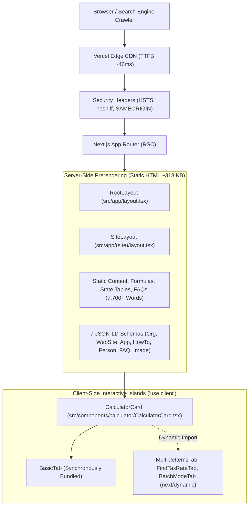

# Codebase Architecture & SEO Implementation Analysis
**Codebase Root:** `C:\All Websites\reverse-tax-calculator`  
**Framework Version:** Next.js 16.4.1 (App Router, Turbopack) | **React Version:** 19.2.4 | **TypeScript:** 5.x | **Styling:** Tailwind CSS 4.x / Custom CSS Variables  
**Deployment Target:** Vercel Global Edge Network  

---

## 1. Architectural Overview & Rendering Strategy

The application is architected around the modern Next.js 16 App Router using React Server Components (RSC) by default. 



### 1.1 Server-Side Prerendering vs. Client-Side Components
- **Indexable Initial HTML:** Every route (`/`, `/us/[state]`, `/canada`, `/vat-calculator`, `/tax-rates`, `/about`) is a Server Component rendered statically at build time (`X-Nextjs-Prerender: 1`).
- **Initial HTML Payload Inspection:** The raw homepage HTML delivered from Vercel is **318,959 bytes** (over 318 KB). It contains all mathematical definitions, statutory rate tables, H1/H2/H3 headings, FAQ questions/answers, and worked examples.
- **Client Component Boundary:** Only interactive form inputs and stateful calculation handlers are marked with `'use client'`:
  - `src/components/calculator/CalculatorCard.tsx`
  - `src/components/calculator/BasicTab.tsx`
  - `src/components/calculator/BatchModeTab.tsx`
  - `src/components/calculator/FindTaxRateTab.tsx`
  - `src/components/calculator/MultipleItemsTab.tsx`
  - `src/components/calculator/EmbedCalculator.tsx`
  - `src/components/Navbar.tsx` (mobile toggle & smooth scroll handler)
  - `src/components/FAQSection.tsx` (accordion toggle state)
  - `src/components/EmbedWidgetSection.tsx` (copy embed code button)
- **Resolution of Historical "White Area" Lead:** Because `BasicTab` is imported statically into `CalculatorCard.tsx` and the card maintains `minHeight: 480px`, the calculator form renders directly in the server HTML. Googlebot encounters zero blank areas or missing content.

---

## 2. Canonicalization, Routing & URL Architecture

### 2.1 Domain & Protocol Normalization
- Enforced at Vercel Edge: HTTP requests redirect to HTTPS (301); www vs non-www redirects to canonical apex `https://salestaxreversecalculator.com`.
- Strict Transport Security (HSTS): `max-age=63072000; includeSubDomains; preload` is active across all non-embed routes.

### 2.2 Redirect Implementation in `next.config.ts`
Lines 11–29 of `next.config.ts` define:
```typescript
async redirects() {
  return [
    {
      source: '/vat-calculator/india',
      destination: '/vat-calculator',
      permanent: true,
    },
    {
      source: '/how-it-works',
      destination: '/#how-it-works',
      permanent: true,
    },
    {
      source: '/faq',
      destination: '/#faq',
      permanent: true,
    },
  ];
}
```
- Live testing confirms `curl -sI https://salestaxreversecalculator.com/how-it-works` returns `HTTP/1.1 308 Permanent Redirect` with `Location: /#how-it-works`.
- **Architectural Debt Identified:** `src/app/(site)/how-it-works/page.tsx` and `src/app/(site)/faq/page.tsx` still exist on disk. While unreachable due to Next.js redirect precedence, they add dead code and confusion to the repository.

### 2.3 Trailing Slash Inconsistency
- In `src/app/layout.tsx`: line 46 declares `canonical: `${SITE_URL}/`` (with trailing slash).
- In `src/app/sitemap.ts`: line 14 declares `url: SITE_URL` (`https://salestaxreversecalculator.com` without trailing slash).
- In subpage metadata (`about/page.tsx`, `us/[state]/page.tsx`, `canada/page.tsx`): all canonicals are declared without trailing slashes (e.g. `https://salestaxreversecalculator.com/about`).
- In rendered HTML on the live homepage: Next.js emits `<link rel="canonical" href="https://salestaxreversecalculator.com"/>` (without slash).
- **Correction Required:** Standardize `src/app/layout.tsx` to `canonical: SITE_URL` (no trailing slash).

---

## 3. Metadata & Structured Data Architecture

### 3.1 Metadata Architecture
Next.js 16 metadata is declared statically on fixed routes and dynamically via `generateMetadata()` on parameterized routes:
- `src/app/(site)/us/[state]/page.tsx`: Uses `generateStaticParams()` to pre-generate all 51 US state pages at build time. Dynamic metadata injects state name, statutory base rate, and customized OpenGraph preview URLs calling `/api/og`.
- `src/app/(site)/canada/[province]/page.tsx`: Pre-generates all 13 Canadian provinces and territories.
- `src/app/(site)/vat-calculator/[country]/page.tsx`: Pre-generates all 7 international VAT countries.

### 3.2 Structured Data (JSON-LD) Breakdown
1. **Homepage (`src/app/(site)/page.tsx` & `src/app/layout.tsx`):**
   - `Organization`: PreTaxPrice brand entity, customer service contact point.
   - `WebSite`: SearchAction entrypoint for rate lookup.
   - `WebApplication`: FinanceApplication specification with free offer tier and feature list.
   - `HowTo`: 3-step procedural calculation proof with formula diagram image.
   - `Person`: CPA / Tax Research Specialist author attribution.
   - `FAQPage`: 6 detailed Q&As with full mathematical proofs.
   - `ImageObject`: Reverse tax formula infographic metadata.
2. **State Pages (`src/app/(site)/us/[state]/`):**
   - `BreadcrumbList`: 3 levels (`Home` -> `US States` -> `[State]`). Verified valid in GSC.
   - `WebApplication`: Localized application declaration.
   - `FAQPage`: Localized state tax Q&As.
   - **Entity Typo in `NewYorkPage.tsx`:** Line 88 sets `name: "New York Sales Tax Calculator"` instead of `"New York Reverse Sales Tax Calculator"`.
   - **Opportunity:** Top 10 state pages lack `HowTo` structured data.

---

## 4. Calculator Quality & Functional Validation

The calculation engine is located in `src/lib/taxCalc.ts`:
- **Core Reverse Tax Formula:**
  $$\text{Pre-Tax Price} = \frac{\text{Final Price}}{1 + \frac{\text{Tax Rate}}{100}}$$
  $$\text{Tax Amount} = \text{Final Price} - \text{Pre-Tax Price}$$
- **Input Validation:**
  - `finalPrice <= 0` throws `'Final price must be greater than 0'`.
  - `taxRate < 0` throws `'Tax rate cannot be negative'`.
- **Rounding Mechanics:** Standard floating-point precision with `roundTo2` ($(\text{amount} + \epsilon) \times 100 / 100$) in API endpoints and `fmt(n)` formatting utility.
- **Embedded Widget (`src/app/embed/page.tsx`):**
  - Standalone minimal layout with `index: false, follow: false, nocache: true`.
  - Frame-ancestor header permits embedding on any third-party domain.
  - Powered-by link uses `rel="nofollow sponsored"` to prevent manipulative PageRank transfer.

---

## 5. Performance, Assets & Core Web Vitals

1. **Font Optimization:**
   - `Montserrat` and `JetBrains_Mono` loaded via `next/font/google` with `display: 'swap'` and `adjustFontFallback: true`. Fonts are locally hosted and preloaded as immutable WOFF2 assets.
2. **Image Optimization:**
   - Next.js `<Image />` component with `formats: ['image/avif', 'image/webp']` and `minimumCacheTTL: 31536000`.
   - Formula diagram (412 KB JPG) served as 46.7 KB WebP.
3. **Speculation Rules API:**
   - `src/app/layout.tsx` lines 112–130 deploys a `<script type="speculationrules">` block prefetching top state destinations (`/us/california`, `/us/texas`, `/us/new-york`, `/us/florida`, `/canada`, etc.) with `eagerness: 'moderate'` for instant page transitions.

---

## 6. Content Architecture & Page Inventory

The site currently indexes **77 distinct production URLs**:
- `1` Homepage (`/`)
- `1` Tax Rates Directory (`/tax-rates`)
- `1` Canada Hub (`/canada`)
- `13` Canadian Province Pages (`/canada/[province]`)
- `1` VAT Hub (`/vat-calculator`)
- `7` International VAT Country Pages (`/vat-calculator/[country]`)
- `51` US State Pages (`/us/[state]` — 50 states + Washington D.C.)
- `4` Informational/Legal Pages (`/about`, `/contact`, `/privacy-policy`, `/terms-of-service`)

### Topical Depth Comparison
- **Tier 1 (High Topical Depth):**
  - Homepage: 7,737 words
  - New York (`/us/new-york`): 2,409 words (ranks pos 9.4)
  - Connecticut (`/us/connecticut`): 1,525 words (ranks pos 10.9)
- **Tier 2 (Custom Component, Moderate Depth):**
  - California (`CaliforniaPage.tsx`): ~1,100 words (ranks pos 22.8)
  - Texas (`TexasPage.tsx`): ~1,050 words (ranks pos 22.8)
  - Florida (`FloridaPage.tsx`): ~1,050 words (ranks pos 18.1)
- **Tier 3 (Programmatic Boilerplate):**
  - 46 remaining US states in `stateContent.ts`: 633–996 words (ranks pos 15–45)
  - International hubs: `/canada` (723 words), `/vat-calculator` (425 words), UK (437 words), Germany (374 words)
