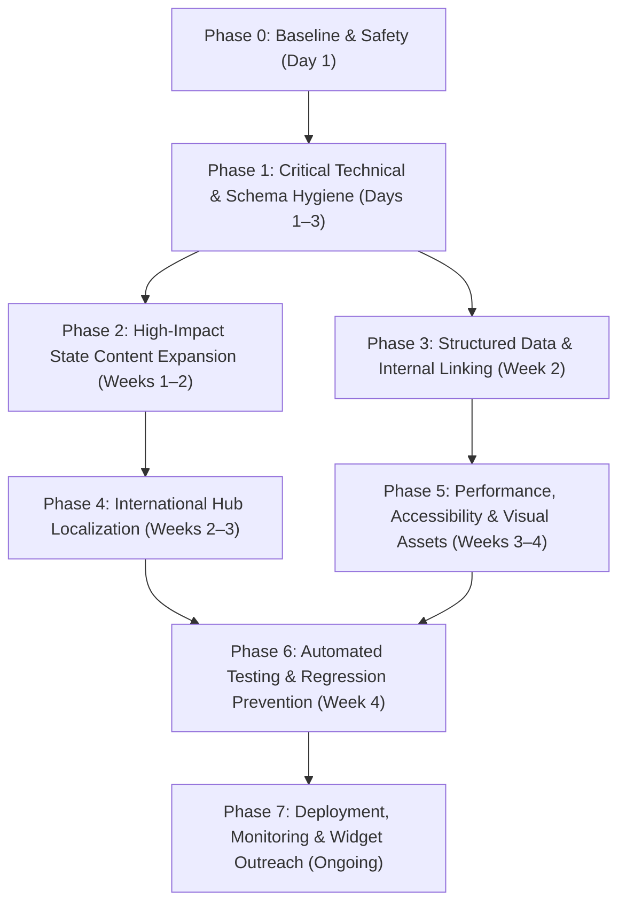

# Phased Implementation Roadmap
**Target:** Climb to #1 for *"reverse sales tax calculator"* and capture Page 1 rankings across top 20 US states and international hubs.  
**Architecture:** Next.js 16 (App Router) + React 19 + TypeScript + Vercel Edge  

---

## Roadmap Overview

---

## Phase 0: Baseline & Safety Setup
- **Objective:** Establish an immutable git rollback point, document baseline crawl and performance metrics, and configure safe branch workflows.
- **Key Tasks:**
  - `TASK-001`: Record current git commit hash, Vercel deployment ID, and build artifacts.
  - `TASK-002`: Run baseline crawl validation and archive current `sitemap.xml` snapshot.
  - `TASK-003`: Verify that local build (`next build`) runs cleanly with zero TypeScript or lint errors.
- **Dependencies:** None.
- **Completion Criteria:** Git baseline tagged (`v2026.10-baseline`); clean local build verification.

---

## Phase 1: Critical Technical SEO & Schema Hygiene
- **Objective:** Consolidate URL equity into canonical endpoints, eliminate dead code, resolve schema entity mismatches, and standardize sitemap formatting.
- **Key Tasks:**
  - `TASK-004`: Safely remove shadowed route files `src/app/(site)/how-it-works/page.tsx` and `src/app/(site)/faq/page.tsx` (redirects in `next.config.ts` are already active).
  - `TASK-005`: Update `public/llms.txt` and `public/llms-full.txt` links from `/how-it-works` and `/faq` to `/#how-it-works` and `/#faq`.
  - `TASK-006`: Fix `WebApplication` schema name on `/us/new-york` in `src/app/(site)/us/[state]/NewYorkPage.tsx` from `"New York Sales Tax Calculator"` to `"New York Reverse Sales Tax Calculator"`.
  - `TASK-007`: Standardize root canonical URL in `src/app/layout.tsx` to `https://salestaxreversecalculator.com` (no trailing slash) to match `src/app/sitemap.ts`.
- **Dependencies:** Phase 0.
- **Completion Criteria:** Zero 404s/308 loops; clean sitemap-to-canonical parity; 100% valid JSON-LD schemas.

---

## Phase 2: High-Impact State Content Expansion
- **Objective:** Break out of the 633–996 word boilerplate template for top search-volume states, replicating the New York (pos 9.4) and Connecticut (pos 10.9) Google Page 1 blueprint.
- **Key Tasks:**
  - `TASK-008`: Expand Texas (`src/app/(site)/us/[state]/TexasPage.tsx`) to 2,000+ words covering Texas Comptroller single local use tax rules, backing-out procedures, and Austin/Houston/Dallas local brackets.
  - `TASK-009`: Expand California (`src/app/(site)/us/[state]/CaliforniaPage.tsx`) to 2,000+ words covering CDTFA Publication 116, district tax boundaries up to 10.75%, and grocery/prescription exemptions.
  - `TASK-010`: Expand Florida (`src/app/(site)/us/[state]/FloridaPage.tsx`) to 1,800+ words covering county discretionary sales surtax $5,000 limitation rules and Form DR-15 reconciliation.
  - `TASK-011`: Create dedicated enriched page for South Carolina (`SouthCarolinaPage.tsx`) covering SC Department of Revenue local option sales tax (LOST) calculation breakdown (1,800+ words).
  - `TASK-012`: Create dedicated enriched page for Arizona (`ArizonaPage.tsx`) covering Transaction Privilege Tax (TPT) reverse calculation mechanics across municipal boundaries (1,800+ words).
- **Dependencies:** Phase 1.
- **Completion Criteria:** 5 priority state pages achieve >1,800 words of verified statutory content, custom FAQ accordions, and city bracket tables.

---

## Phase 3: Structured Data, Visual Cards & Internal Linking
- **Objective:** Maximize search snippet real estate with localized `HowTo` markup, visual rate breakdown cards, and contextual keyword-rich internal links.
- **Key Tasks:**
  - `TASK-013`: Deploy localized `HowTo` structured data across top 10 state pages specifying the exact local tax divisor and mathematical steps.
  - `TASK-014`: Add contextual in-body cross-links from state pages back to the root calculator using descriptive anchors (`free reverse sales tax calculator`, `back out sales tax`).
  - `TASK-015`: Generate lightweight branded SVG/WebP state rate breakdown cards for top 10 states in `public/images/states/` with `ImageObject` schema.
- **Dependencies:** Phase 2.
- **Completion Criteria:** Rich result validator confirms 100% valid `HowTo` and `BreadcrumbList` on all modified state URLs; images render under 35 KB WebP.

---

## Phase 4: International Hub Localization
- **Objective:** Expand international accounting query capture across Canada, the UK, and the EU.
- **Key Tasks:**
  - `TASK-016`: Expand Canada hub (`src/app/(site)/canada/page.tsx`) and top provinces (Ontario, BC, Quebec) with GST/HST/PST/QST blended calculations, CRA input tax credit (ITC) rules, and invoice requirements.
  - `TASK-017`: Deepen UK VAT (`/vat-calculator/united-kingdom`) and Germany VAT (`/vat-calculator/germany`) with cross-border reverse-charge mechanisms (EU Directive Art 194/196, German UStG §13b, UK domestic reverse charge).
- **Dependencies:** Phase 1.
- **Completion Criteria:** Canadian and European VAT hubs exceed 1,500 words of verified tax compliance guidance.

---

## Phase 5: Performance, Accessibility & UX Polish
- **Objective:** Optimize Core Web Vitals and ensure frictionless mobile/keyboard calculator interaction.
- **Key Tasks:**
  - `TASK-018`: Add `experimental: { optimizePackageImports: ['@/components'] }` to `next.config.ts`.
  - `TASK-019`: Enhance `CalculatorCard.tsx` with full WAI-ARIA keyboard arrow navigation (`ArrowLeft`, `ArrowRight`, `Home`, `End`) across tab items.
  - `TASK-020`: Verify mobile viewport stability, touch target spacing (>48x48px), and zero layout shift across all viewports.
- **Dependencies:** Phase 3.
- **Completion Criteria:** Lighthouse performance score >= 95; accessibility score = 100; CLS < 0.02.

---

## Phase 6: Automated Testing & Regression Prevention
- **Objective:** Prevent future regressions with automated CI/CD test coverage.
- **Key Tasks:**
  - `TASK-021`: Implement unit tests for `src/lib/taxCalc.ts` (reverse calculation, negative inputs, zero tax, rounding precision, batch CSV).
  - `TASK-022`: Implement Playwright E2E tests validating HTTP status codes (200, 308, 404), redirect targets, canonical tags, and JSON-LD schema validity.
  - `TASK-023`: Implement sitemap-to-canonical integrity check ensuring all sitemap URLs match rendered canonical headers.
- **Dependencies:** Phases 1–5.
- **Completion Criteria:** 100% passing test suite executed via `npm test`.

---

## Phase 7: Deployment, Monitoring & Authority Building
- **Objective:** Safely release to production, monitor GSC recovery, and expand external domain citations.
- **Key Tasks:**
  - `TASK-024`: Deploy to Vercel preview environment; conduct manual smoke test.
  - `TASK-025`: Execute production release and verify live headers, status codes, and edge caching.
  - `TASK-026`: Monitor Google Search Console impressions and rankings weekly for target state and head keywords.
  - `TASK-027`: Syndicate the embeddable `/embed` accounting widget to finance directories and accounting resource lists.
- **Dependencies:** Phase 6.
- **Completion Criteria:** Verified production release; steady position gains toward Google Page 1 across target states.
