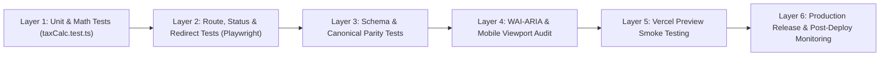

# Testing, Quality Assurance & Deployment Plan
**QA Lead & Technical Auditor:** Senior SEO Quality Assurance Engineer & Full-Stack Architect  
**Objective:** Guarantee zero technical regressions, 100% calculation accuracy, flawless canonical parity, and seamless production rollouts.  

---

## 1. Multi-Layer Testing Architecture

---

## 2. Test Specifications by Layer

### Layer 1: Mathematical Calculation Unit Tests (`src/lib/__tests__/taxCalc.test.ts`)
Must validate `calculateReverseTax`, `findTaxRate`, and `processBatch`:
- **Standard Reverse Calculation:**
  - $107.50 at 7.5% -> Pre-tax: $100.00, Tax: $7.50.
  - $108.875 at 8.875% (NYC) -> Pre-tax: $100.00, Tax: $8.875.
  - $109.50 at 9.50% (LA) -> Pre-tax: $100.00, Tax: $9.50.
- **Zero Tax Rate:** $100.00 at 0% -> Pre-tax: $100.00, Tax: $0.00.
- **High-Rate Boundary:** $200.00 at 27% (Hungary VAT) -> Pre-tax: $157.48, Tax: $42.52.
- **Invalid Inputs:**
  - Negative price (-50) -> Throws `'Final price must be greater than 0'`.
  - Negative tax rate (-5) -> Throws `'Tax rate cannot be negative'`.
  - Zero price (0) -> Throws `'Final price must be greater than 0'`.
- **Batch CSV Processing:**
  - Valid multi-line CSV parses correctly without precision drift.
  - Malformed lines generate isolated error row without crashing batch processor.

### Layer 2: HTTP Status Codes & Redirect Tests
Automated script verifying all edge response codes:
- `GET /` -> HTTP 200 OK.
- `GET /how-it-works` -> HTTP 308 Permanent Redirect to `Location: /#how-it-works`.
- `GET /faq` -> HTTP 308 Permanent Redirect to `Location: /#faq`.
- `GET /vat-calculator/india` -> HTTP 308 Permanent Redirect to `Location: /vat-calculator`.
- `GET /robots.txt` -> HTTP 200 OK (`text/plain`).
- `GET /sitemap.xml` -> HTTP 200 OK (`application/xml`).
- `GET /llms.txt` -> HTTP 200 OK (`text/plain`).
- `GET /non-existent-route-random-xyz` -> HTTP 404 Not Found (valid real 404, not soft-404).

### Layer 3: Metadata, Canonical & Sitemap Integrity Tests
- **Canonical Parity Check:** For every URL in `sitemap.xml`, fetch the page and assert that `<link rel="canonical">` strictly equals the sitemap `<loc>` URL.
- **Trailing Slash Prohibition:** Assert that zero canonical or sitemap URLs contain a trailing slash (except apex if normalized).
- **Noindex Verification:** Assert that `/embed` returns `X-Robots-Tag: noindex, nofollow` and `<meta name="robots" content="noindex, nofollow"/>`.
- **OpenGraph & Twitter Card Tags:** Assert `og:title`, `og:description`, `og:image`, `twitter:card` exist on all core routes.

### Layer 4: Structured Data (JSON-LD) Validation
Automated validation against Schema.org definitions using JSON schema validation:
- **Homepage:** Assert presence and validity of 7 schemas (`Organization`, `WebSite`, `WebApplication`, `HowTo`, `Person`, `FAQPage`, `ImageObject`).
- **New York (`/us/new-york`):** Assert `WebApplication.name` equals `"New York Reverse Sales Tax Calculator"`.
- **Top 10 State Pages:** Assert `HowTo` schema exists, has >= 3 step objects, and includes state-specific divisors.
- **FAQPage Schemas:** Assert all question and answer entities match visible on-page text.

### Layer 5: Mobile Usability & Accessibility (WCAG 2.1 AA)
- **Viewport Checks:** Test responsive layout at 375px (Mobile), 768px (Tablet), 1366px (Laptop), 1920px (Desktop).
- **Horizontal Overflow:** Assert `document.body.scrollWidth === window.innerWidth` (no horizontal scrollbar).
- **Touch Targets:** Assert all buttons, tabs, and links have minimum tap area >= 48x48px (or 44x44px per WCAG).
- **Keyboard Navigation:** Assert calculator tabs navigate via `ArrowLeft` / `ArrowRight` / `Home` / `End`.

### Layer 6: Core Web Vitals Benchmarks
- **Largest Contentful Paint (LCP):** < 1.8s on simulated 4G mobile.
- **Cumulative Layout Shift (CLS):** < 0.02.
- **Interaction to Next Paint (INP):** < 100ms.
- **Time to First Byte (TTFB):** < 100ms globally via Vercel edge cache.

---

## 3. Deployment & Release Protocol

### 3.1 Pre-Deployment Gate
1. Local clean build: `npm run build` must complete with 0 errors and 0 warnings.
2. Full test suite: `npm test` passes 100% of unit and E2E specs.
3. Lint validation: `npm run lint` passes with 0 errors.

### 3.2 Vercel Preview Deployment
1. Git push to branch `preview/seo-enhancements`.
2. Vercel automatically generates isolated preview URL (`https://reverse-tax-calculator-git-...vercel.app`).
3. Execute automated test suite against preview URL.
4. Perform manual visual inspection across Desktop, Tablet, and Mobile.

### 3.3 Production Cutover
1. Merge pull request into `main`.
2. Monitor Vercel production deployment build log.
3. Once live, execute immediate post-deploy smoke check script:
   - Check status codes on `/`, `/how-it-works`, `/faq`, `/us/new-york`, `/us/texas`.
   - Verify edge cache header (`X-Vercel-Cache: HIT` or `MISS` transitioning to `HIT`).
   - Confirm canonical tags on live production endpoints.

### 3.4 Rollback Procedure
If any critical regression occurs (e.g. calculation math error, 500 error, canonical mismatch):
1. Instant Vercel Rollback: In Vercel Dashboard, select previous instant deployment and click "Rollback" (instantaneous DNS-level edge cutover, <30 seconds).
2. Git Rollback: In repository, run `git revert HEAD` or `git reset --hard v2026.10-baseline` and force push to `main`.
3. Post-rollback diagnostic review.

---

## 4. Post-Deployment SEO Monitoring

- **Day 1 Post-Launch:** Manually test 10 core URLs using Google Search Console URL Inspection tool; request re-indexing for updated `/` and `/us/new-york`.
- **Week 1 Post-Launch:** Monitor Search Console "Pages" report for indexation errors, soft-404s, or redirect errors.
- **Weeks 2–4 Post-Launch:** Track impression and position trajectory for target keywords:
  - `"reverse sales tax calculator"`
  - `"texas reverse sales tax calculator"`
  - `"california reverse sales tax calculator"`
  - `"florida reverse sales tax calculator"`
  - `"canada reverse tax calculator"`
