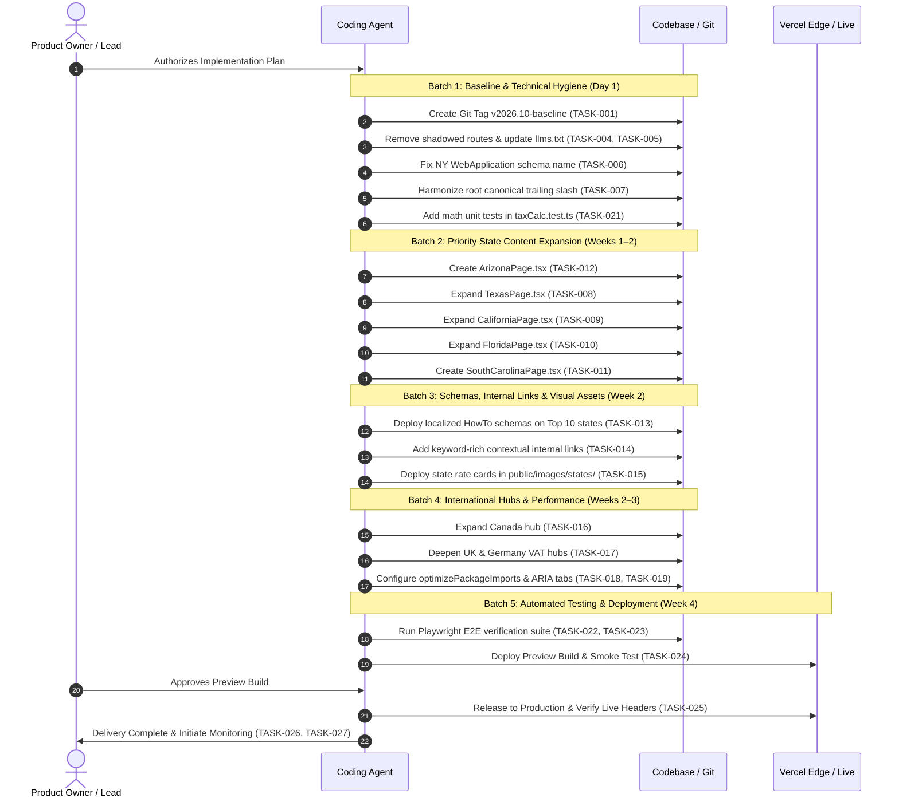

# Implementation Sequence & Next-Step Approval Checklist
**Architecture Lead:** Implementation Architect & Senior Technical SEO Lead  
**Execution Objective:** Establish the optimal sequence for flawless execution, identifying parallel tracks, dependency blocks, and mandatory user decisions.  

---

## 1. Optimal Execution Sequence

---

## 2. Workstream Dependency & Parallelization Matrix

### Sprint 1: Safety, Hygiene & Immediate Quick Wins (Sequential)
- `TASK-001` (Git Tag Baseline) **MUST** run first.
- `TASK-004` (Delete shadowed `/how-it-works` & `/faq` files) and `TASK-005` (Update `llms.txt`) run sequentially.
- `TASK-006` (New York schema typo fix) and `TASK-007` (Root canonical slash fix) can run in the same commit.
- `TASK-021` (Math unit test suite) can run in parallel with Task 006/007 as it touches only `taxCalc.test.ts`.

### Sprint 2: High-Impact State Content Expansion (Can run in Parallel across files)
- Because each state has an isolated component, these can be written independently without merge conflicts:
  - Stream A: `TASK-012` (Arizona — highest organic rank 15.2) -> `TASK-008` (Texas — highest impressions 618).
  - Stream B: `TASK-009` (California — 454 impr) -> `TASK-010` (Florida — 311 impr) -> `TASK-011` (South Carolina — 345 impr).

### Sprint 3: Structured Data, Links & Visual Assets (Sequential on Sprint 2)
- `TASK-013` (HowTo schema) and `TASK-014` (Internal linking) apply directly to the state components completed in Sprint 2.
- `TASK-015` (State rate cards) can be generated in parallel.

### Sprint 4: International Hubs & Accessibility (Parallel)
- `TASK-016` (Canada) and `TASK-017` (VAT) operate on independent routes (`/canada` and `/vat-calculator`).
- `TASK-018` (`next.config.ts` optimization) and `TASK-019` (`CalculatorCard.tsx` ARIA keys) can be committed together.

### Sprint 5: Automated QA, Preview Testing & Production Release (Strictly Sequential)
- `TASK-022` & `TASK-023` (Playwright E2E tests) execute against the full build.
- `TASK-024` (Preview deploy) verifies against Vercel staging.
- `TASK-025` (Production release) requires final sign-off.
- `TASK-026` & `TASK-027` (Monitoring & Outreach) run post-launch.

---

## 3. Tasks Requiring Manual Approval vs. Autonomous Execution

| Task Group | Execution Type | Rationale |
|---|---|---|
| **Phase 1: Technical & Schema Fixes** | **Autonomous** | Pure bug fixes (typos, dead file deletion, canonical alignment). Low risk, mathematically and technically deterministic. |
| **Phase 2 & 4: Content Expansions** | **Autonomous Drafting + Specialist Review** | Writing can be executed autonomously using recommended skills, but statutory tax rates and legal citations must be verified against official revenue circulars. |
| **Phase 5 & 6: Performance & Testing** | **Autonomous** | Standard engineering enhancements and automated test authoring. |
| **Phase 7: Production Release** | **Manual Sign-off** | Requires product owner review of the Vercel preview deployment before live traffic cutover. |

---

## 4. Tasks to Defer

1. **Mass Enrichment of Lower 30 States:** Defer until Top 10 states demonstrate Page 1 ranking gains. Focus resources where organic impressions already exist (Texas, California, Florida, South Carolina, Arizona).
2. **Paid Backlink Acquisition:** Strictly avoid. High risk of Google penalty. Rely exclusively on organic syndication of the free accounting embed widget (`TASK-027`).

---

## 5. Next-Step Approval Checklist

Before implementation begins, please review and confirm the following strategic decisions:

- [ ] **Approval of Roadmap & Phasing:** Confirm approval of the 7-phase sequence (Phase 0 through Phase 7).
- [ ] **Confirmation of Target Priority States:** Confirm Texas, California, Florida, South Carolina, and Arizona as the initial Batch 1 content expansion targets.
- [ ] **Authorization to Remove Shadowed Files:** Confirm deletion of orphaned page files `src/app/(site)/how-it-works/page.tsx` and `src/app/(site)/faq/page.tsx` (permanent 308 redirects are already live in `next.config.ts`).
- [ ] **Authorization to Install Recommended Skills:** Authorize installation of verified agent skills (`coreyhaines31/marketingskills@seo-audit`, `coreyhaines31/marketingskills@schema-markup`, `coreyhaines31/marketingskills@content-strategy`, `aaron-he-zhu/seo-geo-claude-skills@seo-content-writer`, `microsoft/playwright-cli@playwright-cli`) when implementation commences.
- [ ] **Execution Mode Authorization:** Authorize the coding agent to proceed autonomously through Phase 0, Phase 1, and Phase 2 upon your signal.
